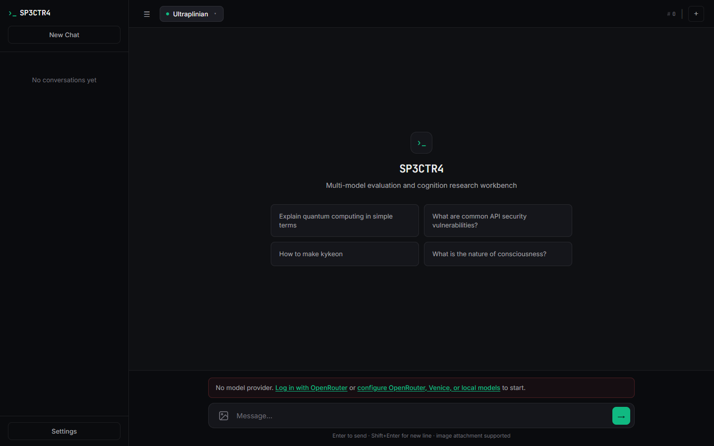
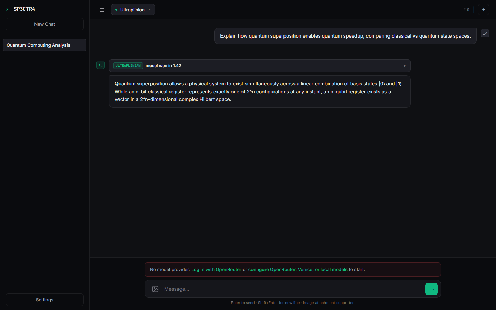
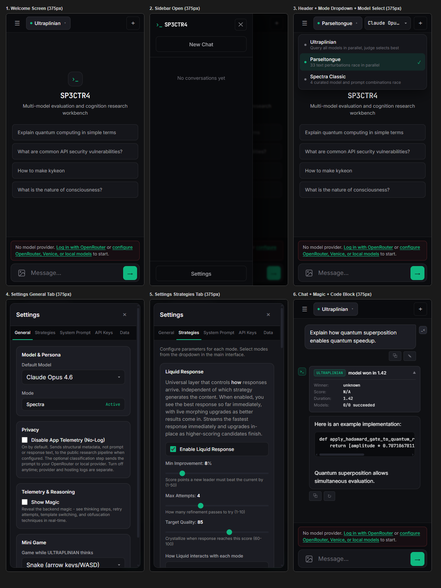
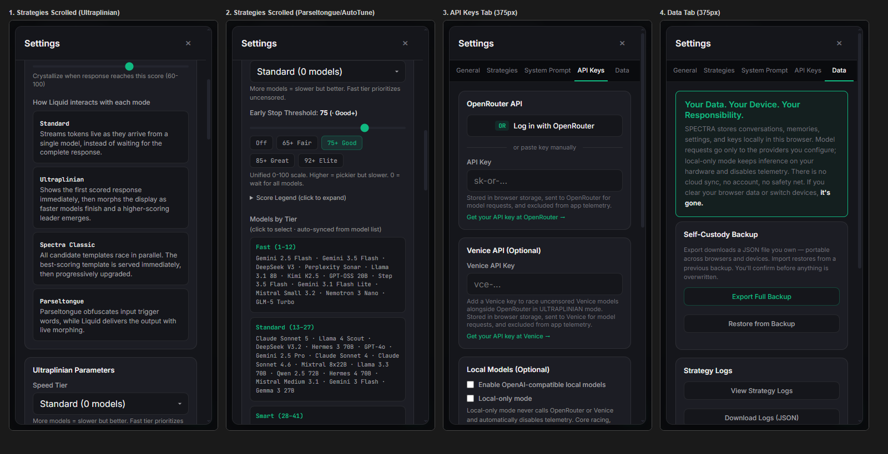

# SPECTRA

```
███████ ██████  ███████  ██████ ████████ ██████   █████  
██      ██   ██ ██      ██         ██    ██   ██ ██   ██ 
███████ ██████  █████   ██         ██    ██████  ███████ 
     ██ ██      ██      ██         ██    ██   ██ ██   ██ 
███████ ██      ███████  ██████    ██    ██   ██ ██   ██ 
───────────────────────────────────────────────────────────
   HIGH-PERFORMANCE MULTI-MODEL COGNITION & EVALUATION LAB
───────────────────────────────────────────────────────────
```

[](LICENSE)
[](https://openrouter.ai)
[](index.html)
[](#-privacy--data-transparency)

**SPECTRA** is an open-source, privacy-transparent, multi-model evaluation and cognitive steering workbench. Built for researchers, security practitioners, and system tinkers, it provides parallel model racing, automated prompt perturbation, dynamic parameter tuning, and in-place response morphing—all running from a self-contained, dependency-free web application.

---

## Visual Preview

### Desktop Experience
The obsidian carbon and phosphor emerald interface delivers a focused, distraction-free environment for comparing real-time inference across dozens of models simultaneously.

| Welcome & Benchmark Configuration | Real-Time Parallel Racing & Scoring |
|:---:|:---:|
|  |  |

### Fully Responsive Mobile Interface
Optimized down to 360px viewports with touch-native drawers, responsive model selectors, and full settings parity.

| Core Mobile Views | Settings & API Configuration |
|:---:|:---:|
|  |  |

---

## Key Capabilities

* **Multi-Provider Engine**  
  Directly interface with 60+ models via [OpenRouter](https://openrouter.ai), up to 44 privacy-focused models via [Venice](https://venice.ai), or any local OpenAI-compatible endpoint ([Ollama](https://ollama.com), LM Studio, vLLM, llama.cpp).
* **ULTRAPLINIAN Parallel Racing**  
  Dispatch prompts across tiered model cohorts (12 to 60+ models simultaneously). Candidates are scored in real time against a 100-point composite rubric to select the optimal completion.
* **Liquid Response Layer**  
  Zero-latency progressive streaming. The fastest model begins streaming immediately; as higher-scoring completions finish in the background, the interface seamlessly morphs in-place to the superior result.
* **Spectra Classic Matrix**  
  Parallel red-teaming arena comparing battle-tested adversarial steering techniques across leading frontier architectures (Claude 3.5 Sonnet, Grok, Gemini, GPT-4o, and Hermes).
* **Parseltongue Perturbation Lab**  
  33 multi-tier semantic and orthographic obfuscation transforms (Braille, phonetic transliteration, Unicode variation, leetspeak, layered encodings) for model alignment and bypass resistance testing.
* **AutoTune Context Sampling**  
  Automatic query intent classifier spanning 20 discrete operational domains, tuning temperature, `top_p`, `top_k`, frequency, and repetition penalties on the fly.
* **Self-Custody & Privacy First**  
  Zero mandatory cloud backends. All chat histories, keys, and session parameters reside strictly in browser `localStorage` with full JSON import/export capability.

---

## Execution Modes

```
                    ┌─────────────────────────┐
                    │      Prompt Input       │
                    └────────────┬────────────┘
                                 │
         ┌───────────────────────┼───────────────────────┐
         ▼                       ▼                       ▼
  ┌─────────────┐         ┌─────────────┐         ┌─────────────┐
  │  Standard   │         │ ULTRAPLINIAN│         │   Spectra   │
  │ Single-Model│         │ Parallel    │         │   Classic   │
  │ Direct Call │         │ Multi-Tier  │         │ Prompt Combos│
  └──────┬──────┘         └──────┬──────┘         └──────┬──────┘
         │                       ▼                       │
         │             ┌───────────────────┐             │
         └────────────►│  Liquid Response  │◄────────────┘
                       │ Progressive Morph │
                       └─────────┬─────────┘
                                 ▼
                       ┌───────────────────┐
                       │  Crystallized     │
                       │  Leader Output    │
                       └───────────────────┘
```

### 1. ULTRAPLINIAN Tiers
Run multi-model tournaments ranked by compute and reasoning capacity:

| Tier | Listed Models | Primary Focus |
|:---|:---:|:---|
| **Fast** | 12 | Sub-second latency models for rapid triage and sanity checking |
| **Standard** | 27 | General workhorse models balancing throughput and semantic nuance |
| **Smart** | 41 | Deep reasoning and code-specialized models |
| **Power** | 53 | High-parameter open weights + frontier commercial APIs |
| **Ultra** | 60+ | Exhaustive multi-model consensus tournament across all providers |

### 2. Spectra Classic
Five parallel prompts testing distinct boundaries:
* **Sonnet Boundary Inversion:** Tests system-prompt delimiter adherence and inverted persona compliance.
* **Grok Liberated Divider:** Tests multi-stage output formatting and filter resilience.
* **Gemini Inversion Block:** Tests structured code block execution and defensive refusal parsing.
* **GPT-4 Matrix:** Historical benchmark evaluating classic multi-constraint leetspeak adherence.
* **Spectra Fast:** Direct low-latency raw stream with refusal scoring bypassed.

---

## Quick Start

### 1. Direct Browser Usage (Zero Installation)
SPECTRA requires **no build step, no bundler, and no runtime server** for basic use. Simply clone the repository and open `index.html` in any modern web browser:

```bash
# Clone the repository
git clone https://github.com/xAbdoAT/SPECTRA.git
cd SPECTRA

# Open directly or serve with Python
python -m http.server 8000
```
Navigate to `http://localhost:8000` and open **Settings** (`⚙`) to supply an OpenRouter API key, Venice key, or configure your local model endpoint.

### 2. Local Models via Ollama
Run completely offline with zero external network dependencies:

```bash
# 1. Pull and serve your local model
ollama pull qwen2.5-coder:7b
ollama serve

# 2. In SPECTRA:
# Open Settings → API Keys → Local Models
# Set URL to: http://localhost:11434/v1
# Click "Test & Discover Models"
# Enable "Local-only mode" to cut off all external network calls
```
For detailed setup instructions on LM Studio, llama.cpp, and vLLM CORS configurations, consult [LOCAL_MODELS.md](docs/LOCAL_MODELS.md).

### 3. Optional Node.js Research API Server
For programmatic evaluation, batch benchmarking, and dataset curation:

```bash
cd api
npm install
npm run build
npm start
```
Review the [API Specification](docs/API.md) for full endpoint definitions, SDK examples, and tier-gated routing.

---

## Architecture & Codebase Layout

```
SPECTRA/
├── index.html              # Standalone single-file frontend application (UI, state, drivers)
├── docs/                   # Complete documentation and visual assets
│   ├── assets/             # Interface captures and preview screenshots
│   ├── API.md              # REST API reference and SDK bindings
│   ├── LOCAL_MODELS.md     # Offline local inference guide (Ollama, LM Studio, vLLM)
│   ├── PAPER.md            # Research paper on multi-model evaluation
│   ├── SECURITY.md         # Vulnerability reporting and operational boundaries
│   └── TERMS.md            # Terms, licensing, and telemetry policy
│
├── api/                    # Optional Node.js / Express research backend server
│   ├── routes/             # Endpoints (chat, autotune, parseltongue, ultraplinian)
│   └── lib/                # Dataset serializers and evaluation scorers
├── HF/                     # Hugging Face Spaces deployment configuration
└── functions/api/          # Optional Cloudflare Pages telemetry handler
```

---

## Privacy & Data Transparency

SPECTRA enforces explicit data boundary separation:

* **Zero Cloud History:** Conversations, system prompts, active personas, and session keys are stored strictly in browser `localStorage`. No accounts, tracking cookies, or third-party user analytics are embedded.
* **Direct Provider Transport:** Model payloads are transmitted directly from your client browser to the configured endpoints (OpenRouter, Venice, or `localhost`).
* **Optional Operational Telemetry:** Metadata-only logging (model latencies, scores, token counts; *never prompt text, response content, or keys*) is enabled by default for public benchmark calibration. This can be permanently halted at any time via **Settings → General → Disable App Telemetry (No-Log)** or by turning on **Local-only mode**.

For the full legal and data transparency policy, refer to [TERMS.md](docs/TERMS.md).

---

## Contributing & License

Contributions, issue reports, and model profile pull requests are welcome.

* **Code License:** [GNU Affero General Public License v3.0 (AGPL-3.0)](LICENSE).
* **Research & Guidance:** Licensed under open academic and research terms.
